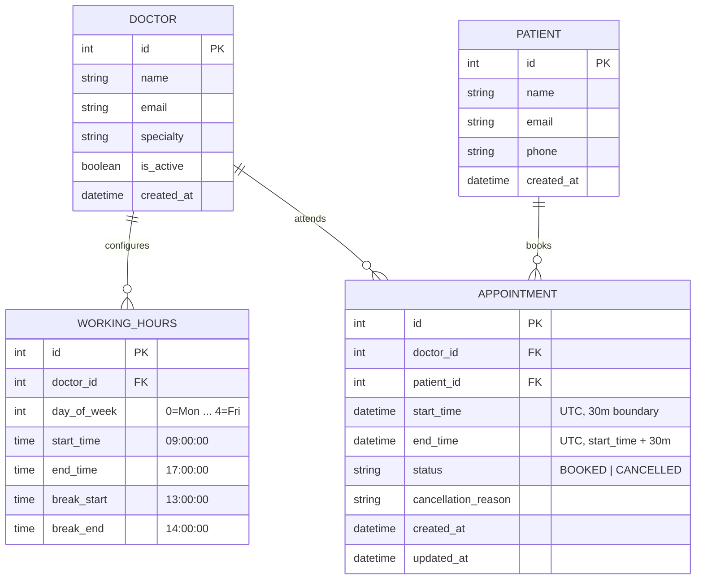
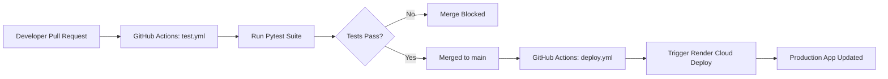

# Savannah Clinic — Appointment Booking System
### Implementation Engineer Assessment Submission

[](https://github.com/Princeyyyy/savannah-clinic/actions/workflows/test.yml)


---

## Quick Submission Links

* **GitHub Repository:** [https://github.com/Princeyyyy/savannah-clinic](https://github.com/Princeyyyy/savannah-clinic)
* **Interactive Live Demo:** [https://savannah-clinic-api-rf3r.onrender.com](https://savannah-clinic-api-rf3r.onrender.com)
* **Interactive OpenAPI Swagger Docs:** [https://savannah-clinic-api-rf3r.onrender.com/docs](https://savannah-clinic-api-rf3r.onrender.com/docs)
* **Section 4 AI Reflection:** [REFLECTION.md](file:///Users/prince/Downloads/Savannah%20Interview%20Question/REFLECTION.md)

---

## Table of Contents
1. [Section 1: System Design](#section-1-system-design)
   - [The Scenario & Problem Statement](#the-scenario--problem-statement)
   - [Domain Entities & Relational Schema](#domain-entities--relational-schema)
   - [Concurrency & Double-Booking Prevention Strategy](#concurrency--double-booking-prevention-strategy)
   - [Key Technical Decisions & Trade-Offs](#key-technical-decisions--trade-offs)
2. [Section 2: API Specification & Architecture](#section-2-api-specification--architecture)
   - [Endpoints Summary](#endpoints-summary)
   - [Advance Scheduling & Patient Appointment Features](#advance-scheduling--patient-appointment-features)
   - [Project Directory Layout](#project-directory-layout)
3. [How to Run Locally (Zero Docker Friction)](#how-to-run-locally-zero-docker-friction)
   - [Setup & Start](#setup--start)
   - [Running the Pytest Test Suite](#running-the-pytest-test-suite)
4. [Section 3: Cloud Deployment & CI/CD](#section-3-cloud-deployment--cicd)
   - [Deployment Target](#deployment-target)
   - [CI/CD Pipeline Architecture](#cicd-pipeline-architecture)
   - [Trigger Branch & Process](#trigger-branch--process)
5. [Section 4: AI Reflection](#section-4-ai-reflection)

---

## Section 1: System Design

### The Scenario & Problem Statement
> *"We run a small clinic with 5 doctors. Patients need to book appointments online. Each doctor has set working hours and works in 30-minute slots. A patient should see which slots are free for a given doctor on a given day, pick one, and book it. Once booked, that slot must not be available to others. Patients should also be able to cancel. We're starting small but want to grow."*

### Domain Entities & Relational Schema



### Concurrency & Double-Booking Prevention Strategy
The core engineering challenge in appointment booking is **preventing race conditions**. If two patients attempt to book Dr. Moraa for Wednesday at 10:00 AM at the exact same millisecond, an application-level `SELECT` followed by `INSERT` will fail due to Time-of-Check to Time-of-Use (TOCTOU).

**Our multi-layered defense:**
1. **Database Partial Unique Index:**
   We enforce database-level serialization using a partial unique index on active bookings:
   ```sql
   CREATE UNIQUE INDEX uq_active_doctor_slot 
   ON appointments (doctor_id, start_time) 
   WHERE status = 'BOOKED';
   ```
   - When an appointment is active (`BOOKED`), no other record with the same `(doctor_id, start_time)` can exist.
   - When an appointment is `CANCELLED`, the partial index condition no longer applies, allowing the slot to be booked again immediately without schema violation.
2. **Atomic Conflict Mapping:**
   Any simultaneous insertion caught by the unique index raises an `IntegrityError` at the database level, which our domain layer cleanly rolls back and maps to an **HTTP 409 Conflict** with an informative message.
3. **Rigorous Verification:**
   Verified via `tests/test_concurrency.py`, which spawns 10 concurrent threads attempting to reserve the exact same slot. Exactly 1 receives `201 Created` and 9 receive `409 Conflict`.

### Key Technical Decisions & Trade-Offs

| Decision | Chosen Approach | Alternative Considered | Trade-Off Justification |
| :--- | :--- | :--- | :--- |
| **Slot Generation** | **Dynamic Computation** | Pre-generated Slot Table | Storing empty slots for future months in a database table introduces immense storage bloat, requires recurring cron generation jobs, and causes sync anomalies whenever doctor hours change. Dynamic generation computes free slots in microseconds by querying working hours minus active bookings. |
| **Database Architecture** | **Hybrid SQLite / PostgreSQL** | Pure PostgreSQL only | Using SQLite locally with zero configuration allows reviewers to clone and run the full test suite in under 1 second. SQLAlchemy ensures full compatibility with managed PostgreSQL in production. |
| **Application Runtime** | **Native Python (`venv`)** | Docker / Containers | Eliminates container startup overhead and local Docker requirements while deploying natively and cleanly on Render's Python runtime. |
| **User Interface** | **Single-Page Portal (`/`)** | Standalone React/Node app | Reviewers get an immediate, visual testing portal served natively by FastAPI with zero Node.js/npm build steps. |

---

## Section 2: API Specification & Architecture

The API adheres to strict REST conventions, returning standard HTTP status codes (`200`, `201`, `400`, `404`, `409`, `422`).

### Endpoints Summary

| Method | Route | Description | Expected Status Codes |
| :--- | :--- | :--- | :--- |
| `GET` | `/` | Web UI Clinic Booking Dashboard | `200 OK` |
| `GET` | `/docs` | Interactive Swagger API Explorer | `200 OK` |
| `GET` | `/health` | Health probe (verifies database connectivity) | `200 OK` / `503 Unavailable` |
| `GET` | `/api/v1/doctors` | List all 5 doctors and working hours | `200 OK` |
| `GET` | `/api/v1/doctors/{id}/availability?date=YYYY-MM-DD` | Return all available 30-min slots on a date | `200 OK`, `400 Bad Request`, `404 Not Found` |
| `POST` | `/api/v1/appointments` | Book an appointment slot | `201 Created`, `400 Bad Request`, `409 Conflict` |
| `PATCH` | `/api/v1/appointments/{id}/cancel` | Cancel an appointment with a reason | `200 OK`, `400 Bad Request`, `404 Not Found` |
| `PATCH` | `/api/v1/appointments/{id}/reschedule` | Move appointment to a new slot | `200 OK`, `400 Bad Request`, `409 Conflict` |
| `GET` | `/api/v1/patients` | List clinic patients | `200 OK` |
| `GET` | `/api/v1/patients/{id}/appointments` | Patient's upcoming appointments sorted chronologically | `200 OK`, `404 Not Found` |

### Advance Scheduling & Patient Appointment Features
1. **Prevention of Bookings Within 1 Hour of Now:**
   Any booking attempt where `start_time < now() + 1 hour` is rejected with `HTTP 400 Bad Request` ("Bookings must be made at least 1 hour(s) in advance").
2. **Patient Upcoming Appointments Endpoint:**
   `GET /api/v1/patients/{id}/appointments` queries only future active bookings (`start_time >= now` and `status == 'BOOKED'`), ordered chronologically (`ORDER BY start_time ASC`).

### Project Directory Layout
```
savannah-clinic/
├── .github/
│   └── workflows/
│       ├── test.yml            # CI: Runs pytest on all pull requests
│       └── deploy.yml          # CD: Triggers auto-deployment on merge to main
├── app/
│   ├── api/
│   │   ├── deps.py             # Database session dependency injection
│   │   └── v1/
│   │       ├── api.py          # Master API router
│   │       └── endpoints/
│   │           ├── appointments.py # Booking, cancellation, rescheduling
│   │           ├── doctors.py      # Doctor listing & availability
│   │           └── patients.py     # Patient records & upcoming bookings
│   ├── core/
│   │   ├── config.py           # Pydantic Settings & environment variables
│   │   └── exceptions.py       # Custom Domain exceptions & HTTP handlers
│   ├── db/
│   │   ├── base.py             # Declarative base & timestamp utilities
│   │   ├── session.py          # Database engine & sessionmaker
│   │   └── init_db.py          # Initial seed script (5 doctors & working hours)
│   ├── models/                 # SQLAlchemy ORM models
│   │   ├── doctor.py
│   │   ├── working_hours.py
│   │   ├── patient.py
│   │   └── appointment.py
│   ├── schemas/                # Pydantic v2 schemas
│   │   ├── doctor.py
│   │   ├── working_hours.py
│   │   ├── patient.py
│   │   └── appointment.py
│   ├── services/               # Core domain business logic
│   │   ├── availability.py     # 30-min slot math & filter engine
│   │   └── booking.py          # Atomic booking controller & state transitions
│   ├── static/
│   │   └── index.html          # Interactive Clinic Portal (Tailwind + JS)
│   └── main.py                 # FastAPI entrypoint, middleware, and lifespan
├── tests/
│   ├── conftest.py             # Test database fixtures & Starlette TestClient
│   ├── test_availability.py    # Availability slot & break filtering tests
│   ├── test_booking.py         # Fresh booking rules & validation tests
│   ├── test_cancel_reschedule.py # Cancellation & reschedule workflows
│   ├── test_bonus_features.py  # 1-hour cutoff & patient booking sorting tests
│   └── test_concurrency.py     # 10-thread concurrent race-condition stress test
├── requirements.txt            # Dependency manifest
├── render.yaml                 # Render Infrastructure-as-Code Blueprint
├── README.md                   # System documentation & submission guide
└── REFLECTION.md               # Section 4 AI Reflection report
```

---

## How to Run Locally (Zero Docker Friction)

### 1. Prerequisites
- Python 3.11+ (Python 3.12 or 3.14 recommended)
- `git`

### 2. Setup & Start
```bash
# 1. Clone repository
git clone https://github.com/Princeyyyy/savannah-clinic.git
cd savannah-clinic

# 2. Create and activate a virtual environment
python3 -m venv .venv
source .venv/bin/activate  # On Windows: .venv\Scripts\activate

# 3. Install dependencies
pip install -r requirements.txt

# 4. Initialize database & seed initial 5 doctors
python -m app.db.init_db

# 5. Start development server
uvicorn app.main:app --reload --port 8000
```

Once running:
- Open your browser to **`http://localhost:8000`** to interact with the **Clinic Dashboard**.
- Open **`http://localhost:8000/docs`** to access the **Interactive Swagger UI**.

### 3. Running the Test Suite
Execute the entire test suite including the concurrency stress test:
```bash
pytest -v
```
*All 19 tests will pass in ~0.25 seconds using the isolated in-memory test database fixture.*

---

## Section 3: Cloud Deployment & CI/CD

### Deployment Target
- **Cloud Provider:** [Render](https://render.com) (Native Python Web Service + Managed PostgreSQL).
- **Public URL:** [https://savannah-clinic-api-rf3r.onrender.com](https://savannah-clinic-api-rf3r.onrender.com)
- **Healthcheck:** `GET https://savannah-clinic-api-rf3r.onrender.com/health` returns `200 OK` with database status `connected`.

### CI/CD Pipeline Architecture



### Which Branch Triggers Deployment & How
1. **Pull Requests (Continuous Integration):**
   - Defined in `.github/workflows/test.yml`.
   - Any pull request targeting the `main` branch automatically triggers GitHub Actions.
   - Sets up Python 3.12, installs dependencies, and runs `pytest -v`. Merges are blocked if any test fails.
2. **Merge to `main` (Continuous Deployment):**
   - Defined in `.github/workflows/deploy.yml`.
   - Pushing or merging code into `main` automatically triggers deployment to Render.
   - If connected directly to GitHub, Render automatically detects the merge and redeploys. Alternatively, the workflow calls the Render Deploy Hook API (`RENDER_DEPLOY_HOOK_URL`).

---

## Section 4: AI Reflection

In accordance with the assessment instructions, our candid reflection on the use of AI tools throughout this project is documented in:
👉 **[REFLECTION.md](file:///Users/prince/Downloads/Savannah%20Interview%20Question/REFLECTION.md)**

It covers:
1. Exact AI usage across all four sections.
2. A concrete example of an AI suggestion that improved the slot calculation algorithm.
3. A critical example where AI generated a flawed, race-condition-prone booking implementation, and how engineering judgment caught and replaced it with a database partial unique index.
4. Two key decisions made independently without AI (dynamic slot calculation and zero-Docker native Python architecture).
